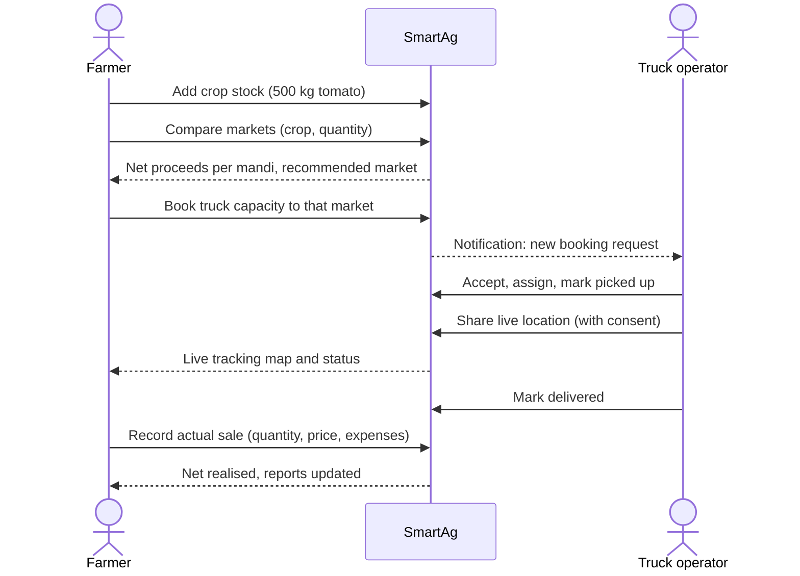
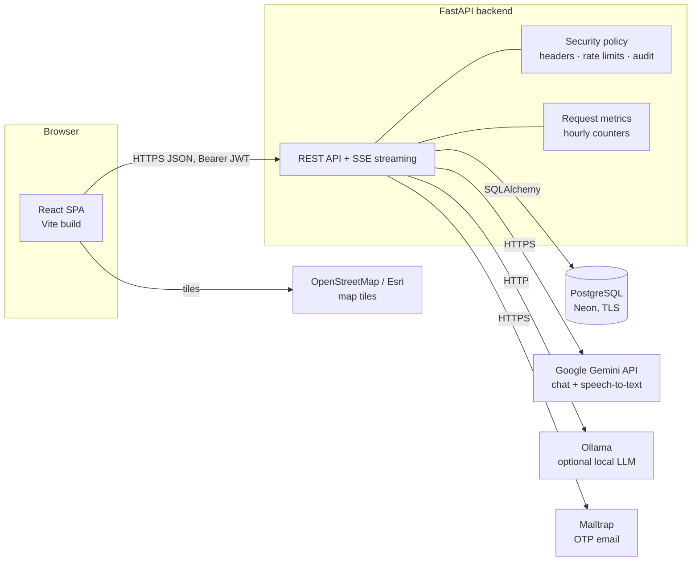
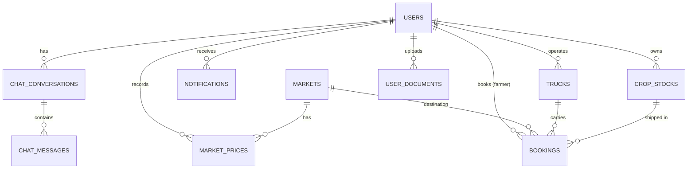
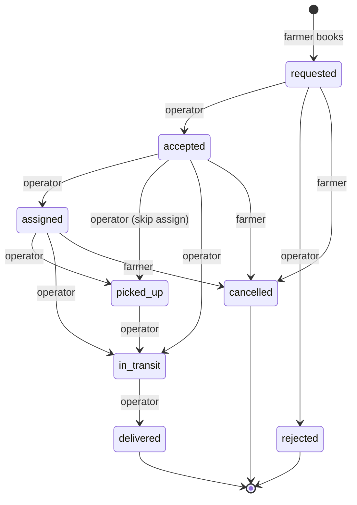

# SmartAg Ops Advisor — Master Document

| | |
|---|---|
| **Product** | SmartAg Ops Advisor ("AgriSave AI" assistant) |
| **Version** | 1.0 (October 2026) |
| **Repository** | `Data-Drive/agri-project` (backend + frontend) |
| **Companion documents** | [`SECURITY.md`](../SECURITY.md) — security policy |

This is the single reference for what the application does, how it is built, how
to run and deploy it, and how to operate it. It is written for the project team,
new developers, reviewers and anyone deploying the system.

---

## Contents

1. [Executive summary](#1-executive-summary)
2. [Problem and goals](#2-problem-and-goals)
3. [Users and roles](#3-users-and-roles)
4. [Feature catalogue](#4-feature-catalogue)
5. [Key user journeys](#5-key-user-journeys)
6. [System architecture](#6-system-architecture)
7. [Technology stack](#7-technology-stack)
8. [Repository structure](#8-repository-structure)
9. [Data model](#9-data-model)
10. [Business rules](#10-business-rules)
11. [API reference](#11-api-reference)
12. [AI assistant and voice input](#12-ai-assistant-and-voice-input)
13. [Security summary](#13-security-summary)
14. [Configuration](#14-configuration)
15. [Local setup](#15-local-setup)
16. [Deployment](#16-deployment)
17. [Operations and monitoring](#17-operations-and-monitoring)
18. [Quality and testing](#18-quality-and-testing)
19. [Known limitations and roadmap](#19-known-limitations-and-roadmap)
20. [Glossary](#20-glossary)

---

## 1. Executive summary

SmartAg Ops Advisor helps small farmers sell their harvest at the most profitable
market (*mandi*) and move it there on shared trucks. A farmer records their crop
stock, compares markets by **net proceeds after transport, labour, commission and
packaging**, books spare capacity on a truck, and tracks the trip live. Truck
operators publish their vehicles, accept bookings and share location during trips.
Administrators manage users, review driver documents and monitor platform health.
An agriculture-only AI assistant answers farming questions in ten Indian languages,
by text or voice.

## 2. Problem and goals

**Problem.** Farmers usually sell at the nearest mandi because comparing prices and
arranging transport is hard. The highest headline price is often not the best
deal once transport and market costs are paid, and hiring a full truck for a small
load is expensive.

**Goals**

| # | Goal | How the app delivers it |
|---|---|---|
| G1 | Sell where the farmer earns the most | Market comparison by net proceeds, using recorded prices and real costs |
| G2 | Cheaper transport | Shared trucks: book only the capacity needed |
| G3 | Trust and visibility | Live trip tracking, booking status timeline, delivery records |
| G4 | Accessible to rural users | 10 languages, voice input, mobile-first layout |
| G5 | Safe operation | Role-based access, admin MFA, audit logging, security policy |

## 3. Users and roles

| Role | Who | Can sign up publicly | Main capabilities |
|---|---|---|---|
| **Farmer** | Grower selling produce | Yes | Crop stock, market comparison, truck booking, tracking, reports, AI assistant |
| **Truck Operator** | Owner/driver of a truck | Yes | Fleet management, booking requests, trips, location sharing, driver documents |
| **Market Price Manager** | Mandi staff | No (assigned by admin) | Publish time-stamped market prices |
| **Buyer / General Public** | Traders, visitors | No (assigned by admin) | View prices and markets |
| **Admin** | Platform operator | No (provisioned from configuration) | User management, role changes, user removal, document review, platform dashboard |

`marketer` exists as a legacy role and is treated like a buyer.

### What each role sees in the menu

| Page | Farmer | Truck Operator | Price Manager / Buyer | Admin |
|---|:-:|:-:|:-:|:-:|
| Dashboard | Farmer dashboard | Operator dashboard | Farmer dashboard | **Admin dashboard** |
| My Crops | ✓ | | | |
| Market Prices | ✓ | | ✓ | |
| Find Markets | ✓ | | ✓ | |
| Truck Booking / My trucks | ✓ (book) | ✓ (manage) | | |
| Live Tracking | ✓ | ✓ | | |
| My Bookings | ✓ | | | |
| Booking Requests, My Trips, Notifications | | ✓ | | |
| Reports | ✓ | | ✓ (price manager) | ✓ |
| AI Assistant | ✓ | ✓ | ✓ | ✓ |
| Profile | ✓ | ✓ (+ vehicle & documents) | ✓ | ✓ |
| Admin (users) | | | | ✓ |

Menu visibility is a convenience; every rule is also enforced by the backend.

## 4. Feature catalogue

### 4.1 Accounts and access
- Sign up with email (or mobile) as Farmer or Truck Operator.
- Sign in with email or mobile number and password.
- **Admin two-step sign-in**: after the password, a 6-digit code is emailed (Mailtrap).
- Forgot password: emailed one-time code → verify → set a new password.
- Account lockout after 5 wrong passwords (15 minutes).
- Profile editing; truck operators also store vehicle type, number and capacity.

### 4.2 Farmer
- **Dashboard**: crop stock, best nearby price, available trucks, estimated net profit,
  nearby markets map, market comparison, latest prices, available trucks.
- **My Crops**: add/edit/close crop listings (crop, variety, quantity, grade,
  harvest date, pickup location, cost per kg, status).
- **Market Prices → Government mandi prices** (default tab): official Agmarknet
  prices (data.gov.in) exactly as published — min, max and modal price per quintal
  plus ₹/kg, by state, district, market, commodity, variety and grade, with the
  source and arrival date shown. Loaded from CSV files in `dataset/` (or the
  data.gov.in API), refreshed automatically, 30 days of history kept.
- **Market Prices → Recorded by managers**: manager-entered price board with
  highest/average price and staleness (older than 48 h).
- **Find Markets (market finder)**: for a crop and quantity, compares government
  mandi prices across markets after **real road distance** (OSRM) and every cost,
  from the farmer's GPS position, a typed village/town, a point tapped on the map,
  or the crop's pickup location. Shows four picks — **Best profit** (most money in
  hand, recommended), **Best crop price**, **Nearest**, **Quickest trip** — a ranked
  list, a Leaflet map with the road route, and a full cost breakdown. Transport uses
  the cheapest truck listed in the app that can carry the load (base fare + ₹/km).
  Market locations come from OpenStreetMap (district centre, marked approximate,
  when the exact market is not found or is a same-name place elsewhere).
- **Market comparison**: net proceeds per market for a crop and quantity (§10.3).
- **Truck Booking**: browse shared trucks by free capacity and route; book capacity.
- **My Bookings**: booking list with status tabs, details, cancellation, recorded sale.
- **Live Tracking**: trip map (small view with Google-Maps-style full screen,
  map/satellite switch), status timeline, last reported location.
- **Reports**: stock, sales and transport performance.

### 4.3 Truck operator
- **Operator dashboard**: pending requests, active trips, available trucks, completed trips.
- **My trucks**: add trucks with capacity, route, pricing (base fare + per km),
  availability date, passenger seat.
- **Booking Requests**: accept or reject farmer requests.
- **My Trips**: move trips through assigned → picked up → in transit → delivered.
- **Location sharing**: with the farmer's consent, report GPS position during a trip.
- **Driver documents**: upload vehicle permit and both sides of the driving licence
  (inside "Edit profile"; saved with *Save changes*).

### 4.4 Market price manager
- Publish crop prices per market with source and observation time.

### 4.5 Admin
- **Admin dashboard**: total users, farmers, truck operators, AI chat users;
  users-by-role chart; AI chatbot usage chart; application request monitor
  (requests, average response time, 4xx and 5xx errors) for 24 h / 7 d / 30 d.
- **User management**: search and filter users, change roles, remove users
  (with confirmation; removes their data — §10.6).
- **Driver document review** via API (`/api/auth/users/{id}/documents`).

### 4.6 Shared
- **AI Assistant ("AgriSave AI")**: farming-only answers, conversation history,
  Gemini (cloud) or Ollama (local) model switch, streaming replies.
- **Voice input**: microphone button; speech transcribed in the selected language.
- **10 languages**: English, Hindi, Tamil, Telugu, Kannada, Malayalam, Marathi,
  Bengali, Gujarati, Punjabi.
- **Notifications** and **global search** (crops, markets, trucks).

## 5. Key user journeys

### 5.1 Farmer sells a harvest



### 5.2 Admin signs in

1. Enter admin email and password on the normal sign-in page.
2. A 6-digit code is emailed; enter it (10-minute expiry, 5 attempts, resend after 60 s).
3. Land on the admin dashboard.

## 6. System architecture



- **Frontend**: single-page React app. Talks to the API with a JWT in the
  `Authorization` header; streams AI replies over Server-Sent Events.
- **Backend**: stateless FastAPI app. Tables are created/migrated on startup.
- **Database**: PostgreSQL (hosted on Neon). Images (driver documents) are stored
  in the database.
- **External services**: Gemini (AI chat and voice transcription), Mailtrap (OTP
  emails), map tile providers. Ollama is an optional local alternative for chat.

## 7. Technology stack

| Layer | Technology |
|---|---|
| Frontend | React 18, React Router 6, Vite 5, Axios, Leaflet + React-Leaflet, plain CSS |
| Backend | Python 3.12, FastAPI 0.115, Uvicorn, SQLAlchemy 2, Pydantic 2 |
| Auth | python-jose (JWT HS256), passlib + bcrypt |
| Database | PostgreSQL (Neon serverless), psycopg2 |
| AI | Google Gemini (`gemini-flash-latest` chat, `gemini-flash-lite-latest` speech), Ollama (`llama3.2:3b`, optional) |
| Email | Mailtrap Email Sending API (SMTP fallback supported) |
| Maps | OpenStreetMap tiles, Esri World Imagery (satellite) |

## 8. Repository structure

```
Data-Drive/
├── SECURITY.md                 Security policy
├── docs/MASTER_DOCUMENT.md     This document
└── agri-project/
    ├── backend/
    │   ├── .env / .env.example Configuration (never commit .env)
    │   ├── requirements.txt
    │   └── app/
    │       ├── main.py          App setup, CORS, migrations, routers
    │       ├── core/            config, database, security (JWT, hashing, OTP),
    │       │                    security_policy, metrics, email, db_init
    │       ├── models/          SQLAlchemy tables
    │       ├── schemas/         Pydantic request/response models
    │       └── routers/         auth, admin, documents, chat, crops,
    │                            markets, trucks, bookings, dashboard
    └── frontend/
        ├── vite.config.js       Dev server, security headers, build CSP
        ├── scripts/             Translation generation
        └── src/
            ├── App.jsx          Routes and role guards
            ├── components/      AppShell, TripMap, LineChart, Modal, Icons …
            ├── context/         AuthContext, LanguageContext
            ├── hooks/           useVoiceInput
            ├── i18n/            messages.js (English source), translations.js
            ├── pages/           One file (+ CSS) per page
            ├── services/        API clients
            └── utils/           dates, password policy
```

## 9. Data model



| Table | Purpose | Key columns |
|---|---|---|
| `users` | Accounts and roles | email, phone, hashed_password, role, vehicle_*, failed_login_attempts, locked_until, password_changed_at |
| `crop_stocks` | Farmer harvest listings | owner_id, crop_name, variety, quantity_kg, grade, harvest_date, pickup_location, cost_per_kg, status |
| `markets` | Mandis | name, district, state, latitude, longitude, distance_km |
| `market_prices` | Time-stamped prices | market_id, crop_name, price_per_kg, source, observed_at, created_by |
| `trucks` | Shared vehicles | operator_id, vehicle_number, capacity_kg, available_capacity_kg, route_from/to, price_per_km, base_fare, status, last_lat/lng |
| `bookings` | Transport bookings | farmer_id, truck_id, crop_id, market_id, quantity_kg, status, distance_km, eta_minutes, estimated costs, actual sale fields, location_consent, last_lat/lng |
| `notifications` | In-app alerts | user_id, title, message, link, is_read |
| `chat_conversations`, `chat_messages` | AI chat history | user_id, title / role (`user`, `assistant`), content |
| `user_documents` | Driver permit and licence images | user_id, doc_type (`permit`, `license_front`, `license_back`), content_type, size, data |
| `password_reset_otps`, `admin_login_otps` | One-time codes | email, otp_hash (HMAC), attempts, consumed, expires_at |
| `api_request_stats` | Hourly API metrics | hour_start, requests, client_errors, server_errors, total_ms |

**Deletion rules** (enforced by the database): deleting a user cascades to their
crops, bookings (as farmer), notifications, chats and documents; trucks and price
records are kept with the user link set to empty.

## 10. Business rules

### 10.1 Crop status
`draft` → `available` → `reserved` / `partially_sold` → `sold` → `closed`.
Only `available`, `reserved` and `partially_sold` count as stock.

### 10.2 Booking lifecycle



- Active statuses: `requested`, `accepted`, `assigned`, `picked_up`, `in_transit`.
- Operators move bookings forward (they may skip `assigned` / `picked_up`) and can
  reject new requests; farmers can only cancel, and only before pickup.
- Location is shared only during `picked_up` / `in_transit` and only with the
  farmer's consent.
- After delivery the farmer records the actual sold quantity, price and expenses.

### 10.3 Market comparison (net proceeds)

For a crop quantity *Q* (kg) and a market with latest price *P* (₹/kg) at distance *D* (km):

| Step | Formula | Default setting |
|---|---|---|
| Saleable quantity | Q × (1 − loss %) | `MARKET_LOSS_PCT` = 2 % |
| Gross revenue | saleable × P | |
| Transport | D × rate + loading | `TRANSPORT_RATE_PER_KM` = ₹28, `LOADING_COST` = ₹500 |
| Labour | Q × labour rate | `LABOUR_COST_PER_KG` = ₹0.40 |
| Commission | gross × commission % | `COMMISSION_PCT` = 2 % |
| Packaging | Q × packaging rate | `PACKAGING_COST_PER_KG` = ₹0.25 |
| **Net proceeds** | gross − (transport + labour + commission + packaging) | |

If the farmer entered a cost per kg, profit is also estimated. Prices older than
`STALE_PRICE_HOURS` (48 h) are flagged as stale.

### 10.4 Truck status
`available`, `reserved`, `on_trip`, `maintenance`, `inactive`. Only `available`
trucks are offered to farmers. A deleted operator's trucks become `inactive`.

### 10.5 Account rules
- Public sign-up: Farmer or Truck Operator only. Admins come from configuration
  (`ADMIN_EMAIL`); other roles are assigned by an admin.
- Passwords: 8+ characters with a letter and a number, not common, not the email name.
- Admins cannot change their own role or remove themselves; the last admin cannot be removed.

### 10.6 User removal
Permanent. Removes the user and the data listed in §9; their sessions stop working.

## 11. API reference

Base URL: `http://localhost:8000` in development. All endpoints except sign-up,
sign-in, password reset and health require `Authorization: Bearer <token>`.
Interactive docs: `/docs` (development only).

### Auth and users — `/api/auth`
| Method | Path | Who | Purpose |
|---|---|---|---|
| POST | `/signup` | Public | Create Farmer / Truck Operator account |
| POST | `/login` | Public | Sign in; admins receive an OTP challenge instead of a token |
| POST | `/login/verify-otp` | Public | Admin: verify emailed code, get session |
| POST | `/login/resend-otp` | Public | Admin: resend code |
| POST | `/forgot-password` | Public | Email a reset code |
| POST | `/verify-otp` | Public | Verify reset code, get reset token |
| POST | `/reset-password` | Public | Set new password (signs out all sessions) |
| GET / PATCH | `/me` | Signed in | Read / update own profile |
| GET | `/users` | Admin | List users |
| PATCH | `/users/{id}/role` | Admin | Change a user's role |
| DELETE | `/users/{id}` | Admin | Remove a user and their data |

### Driver documents — `/api/auth`
| Method | Path | Who | Purpose |
|---|---|---|---|
| GET | `/me/documents` | Operator | List own documents |
| GET / PUT / DELETE | `/me/documents/{type}` | Operator | View / upload / delete (`permit`, `license_front`, `license_back`) |
| GET | `/users/{id}/documents[/{type}]` | Admin | Review a user's documents |

### Farming operations — `/api`
| Method | Path | Purpose |
|---|---|---|
| GET / POST | `/crops` | List / add crop stock |
| PATCH / DELETE | `/crops/{id}` | Update / remove crop stock |
| GET | `/markets`, `/markets/{id}` | Markets |
| GET | `/markets/compare` | Net-proceeds comparison |
| GET | `/markets/{id}/prices` | Price history |
| GET / POST | `/prices` | List prices / publish price (price manager, admin) |
| GET | `/prices/crops` | Crops that have prices |
| GET / POST | `/trucks` | List / add trucks |
| GET / PATCH / DELETE | `/trucks/{id}` | Truck detail / update / remove |
| GET / POST | `/bookings` | List / create bookings |
| GET | `/bookings/{id}` | Booking detail |
| PATCH | `/bookings/{id}/status` | Change status (rules in §10.2) |
| PATCH | `/bookings/{id}/delivery` | Record actual sale |
| PATCH | `/bookings/{id}/location` | Report live location |
| GET | `/dashboard` | Role dashboard data |
| GET | `/reports/summary` | Reports |
| GET / PATCH | `/notifications`, `/notifications/{id}/read`, `/notifications/read-all` | Notifications |
| GET | `/search` | Global search |

### Government mandi prices — `/api/mandi-prices`
| Method | Path | Who | Purpose |
|---|---|---|---|
| GET | `/api/mandi-prices` | Signed in | Prices for the latest date (filters: `state`, `district`, `market`, `commodity`, `q`, `arrival_date`; `sort`; paging) |
| GET | `/api/mandi-prices/filters` | Signed in | States, districts and commodities for the dropdowns |
| GET | `/api/mandi-prices/history` | Signed in | Stored daily prices for one market and commodity |
| GET | `/api/mandi-prices/status` | Signed in | Source, latest date, record count, last load |
| POST | `/api/mandi-prices/sync` | Admin | Reload now from the configured source |

Source settings: `MANDI_SOURCE` (`dataset` — CSV files in `dataset/` with columns
`state, district, market, commodity, variety, grade, arrival_date (dd/mm/yyyy),
min_price, max_price, modal_price`; or `api` — data.gov.in with `DATA_GOV_API_KEY`),
`MANDI_DATASET_DIR`, `MANDI_SYNC_INTERVAL_HOURS`, `MANDI_RETENTION_DAYS`.

### Market finder — `/api/market-finder`
| Method | Path | Purpose |
|---|---|---|
| GET | `/api/market-finder?commodity=&quantity_kg=` (+ `lat`/`lng`, `place`, `crop_id`, `cost_per_kg`) | Ranked markets with road km, drive time, costs, money in hand, profit, and the four picks |
| GET | `/api/market-finder/commodities` | Crops with government prices on the latest date |
| GET | `/api/market-finder/route?o_lat=&o_lng=&d_lat=&d_lng=` | Road path for the map |

Caches: `geocode_cache` (OpenStreetMap lookups) and `route_cache` (OSRM road
distance/time). Markets are located in the background after each price import
(1 lookup/second); routing is limited to a shortlist (20 nearest + 12 best-priced)
with a 20-second budget per search — unfinished routes are cached for the next
search and never estimated.

### AI — `/api/chat`
| Method | Path | Purpose |
|---|---|---|
| GET | `/status` | Which AI providers are available |
| GET / POST | `/conversations` | List / start conversations |
| GET / PATCH / DELETE | `/conversations/{id}` | Read / rename / delete |
| POST | `/conversations/{id}/messages` | Ask (full reply) |
| POST | `/conversations/{id}/messages/stream` | Ask (streamed reply, SSE) |
| POST | `/transcribe` | Voice to text (multipart: `audio`, `language`) |

### Admin and system
| Method | Path | Purpose |
|---|---|---|
| GET | `/api/admin/overview?range=24h\|7d\|30d` | Admin dashboard data |
| GET | `/api/health` | Health check |

## 12. AI assistant and voice input

- **Scope**: answers only farming topics (crops, soil, livestock, weather, mandi
  prices, equipment, government schemes); declines other topics in one sentence;
  never invents prices or schemes.
- **Language**: replies in the user's selected app language.
- **Providers**: Gemini (default, cloud) or Ollama (local, optional), chosen in the chat header.
- **Limits**: answers ≈ 200 tokens, last 6 messages of history, 1,200-character input.
- **Voice**: up to 60 seconds; the browser converts audio to 16 kHz WAV; the
  backend sends it to Gemini (`gemini-flash-lite-latest`, falling back to the main
  model when busy) and returns text in the native script without translating.
  Audio is not stored. Typical latency 6–25 s depending on Gemini load.
- **Rate limits**: 20 chat messages and 10 transcriptions per minute per client.

## 13. Security summary

Full policy: [`SECURITY.md`](../SECURITY.md). Highlights:

- bcrypt password hashing, password policy, account lockout, admin email MFA.
- JWT sessions (24 h) revoked on password reset; purpose tokens cannot be used as sessions.
- Role checks on every protected endpoint; self-registration limited to two roles.
- Per-IP rate limits on authentication, OTP and AI endpoints.
- Security headers (CSP, frame denial, nosniff, referrer and permissions policy, HSTS in production).
- Strict CORS, 12 MB request cap, validated uploads, parameterised SQL.
- Audit log of security events; production mode refuses weak secrets and hides API docs.

## 14. Configuration

Backend settings come from `agri-project/backend/.env` (template: `.env.example`).

| Group | Variables |
|---|---|
| Environment | `ENVIRONMENT` (`development` / `production`) |
| Core | `SECRET_KEY`, `DATABASE_URL`, `FRONTEND_URL`, `ACCESS_TOKEN_EXPIRE_MINUTES` |
| Security | `PASSWORD_MIN_LENGTH`, `LOGIN_MAX_FAILURES`, `LOGIN_LOCKOUT_MINUTES`, `MAX_REQUEST_BYTES` |
| Admin | `ADMIN_EMAIL`, `ADMIN_DEFAULT_PASSWORD`, `ADMIN_NAME` |
| AI | `GEMINI_API_KEY`, `GEMINI_MODEL`, `GEMINI_SPEECH_MODEL`, `GEMINI_TIMEOUT_SECONDS`, `AI_MAX_OUTPUT_TOKENS`, `AI_MAX_HISTORY_MESSAGES`, `AI_MAX_INPUT_CHARS`, `OLLAMA_BASE_URL`, `OLLAMA_MODEL`, `OLLAMA_TIMEOUT_SECONDS` |
| Costs | `TRANSPORT_RATE_PER_KM`, `LOADING_COST`, `MARKET_LOSS_PCT`, `LABOUR_COST_PER_KG`, `COMMISSION_PCT`, `PACKAGING_COST_PER_KG`, `STALE_PRICE_HOURS` |
| OTP | `OTP_EXPIRE_MINUTES`, `OTP_RESEND_SECONDS`, `OTP_MAX_ATTEMPTS`, `RESET_TOKEN_EXPIRE_MINUTES` |
| Email | `MAILTRAP_API_TOKEN`, `MAILTRAP_API_URL`, `MAILTRAP_FROM_EMAIL`, `MAILTRAP_FROM_NAME`, `SMTP_*` (fallback) |

Frontend: `agri-project/frontend/.env` → `VITE_API_URL` (API base URL).

## 15. Local setup

**Prerequisites**: Python 3.12, Node.js 20+, a PostgreSQL database (local or Neon).

```bash
# Backend
cd agri-project/backend
python -m venv venv
venv\Scripts\activate            # Windows  (macOS/Linux: source venv/bin/activate)
pip install -r requirements.txt
copy .env.example .env           # then fill in SECRET_KEY, DATABASE_URL, keys
python -m uvicorn app.main:app --reload --host 127.0.0.1 --port 8000

# Frontend (new terminal)
cd agri-project/frontend
npm install
copy .env.example .env           # VITE_API_URL=http://localhost:8000
npm run dev                      # http://localhost:5173
```

On first start the backend creates all tables and the admin account from
`ADMIN_EMAIL` / `ADMIN_DEFAULT_PASSWORD`. If no email provider is configured,
OTP codes are printed in the backend console and shown in the UI (development only).

## 16. Deployment

1. **Database**: PostgreSQL with TLS (`sslmode=require`), backups enabled.
2. **Backend**: run `uvicorn app.main:app --host 0.0.0.0 --port 8000` behind an
   HTTPS reverse proxy with **one worker** (rate limits and metrics are in memory),
   `ENVIRONMENT=production`, a strong `SECRET_KEY`, and `FRONTEND_URL=https://…`.
3. **Frontend**: `npm run build` with `VITE_API_URL=https://<api-host>`; serve
   `dist/` over HTTPS with SPA fallback to `index.html` and the security headers
   in `SECURITY.md` §6 (including `frame-ancestors 'none'`).
4. **Secrets**: rotate every key that was ever shared; change the default admin password.
5. Work through the checklist in `SECURITY.md` §13.

## 17. Operations and monitoring

| What | Where |
|---|---|
| Health | `GET /api/health` → `{"status": "ok"}` |
| Users, AI usage, API traffic and errors | Admin dashboard |
| Security events | Backend log, logger `smartag.security` (logins, lockouts, role changes, deletions, rate limits) |
| Request metrics storage | `api_request_stats` table (hourly, flushed every minute) |
| Startup warnings | Weak `SECRET_KEY`, admin password below policy |

**Routine tasks**: review lockout and rate-limit events weekly; check 5xx rate on
the admin dashboard; keep dependencies patched (`pip list --outdated`, `npm audit`);
verify database backups.

## 18. Quality and testing

- Changes in this release were verified with scripted end-to-end checks against
  throwaway databases (auth, OTP, lockout, session revocation, rate limits, uploads,
  user removal, admin metrics) and browser checks of every page for each role at
  desktop and phone widths.
- **There is no automated test suite in the repository yet.** Adding one
  (pytest for the API, Playwright for key journeys) is the top quality item on the roadmap.

## 19. Known limitations and roadmap

**Known limitations**
- Rate limits and request metrics are per process (single worker only).
- No admin screen yet for reviewing driver documents (API only) or managing markets.
- Market prices depend on price managers entering them; there is no external price feed.
- AI response and voice transcription speed depend on Gemini load.
- Voice recognition was verified with English speech; other languages rely on Gemini support.
- Sessions are stored in browser `localStorage` (mitigated by the CSP).
- New interface text is in English until translations are regenerated
  (`frontend/scripts/generate-translations.mjs`).

**Roadmap (suggested)**
1. Automated tests and CI.
2. Admin pages for document verification and market management.
3. Shared store (Redis) for rate limits; multi-worker deployment.
4. Government price feed integration (e.g. Agmarknet) alongside manual prices.
5. SMS / WhatsApp OTP and notifications for users without email.
6. Offline-friendly mobile experience (PWA).

## 20. Glossary

| Term | Meaning |
|---|---|
| Mandi | Regulated agricultural market |
| Net proceeds | Money the farmer keeps after transport and market costs |
| Shared truck | A truck whose spare capacity is sold to several farmers |
| OTP | One-time password (6-digit code) sent by email |
| MFA | Multi-factor authentication (password + emailed code for admins) |
| Stale price | Price older than 48 hours |
| SSE | Server-Sent Events, used to stream AI replies |
